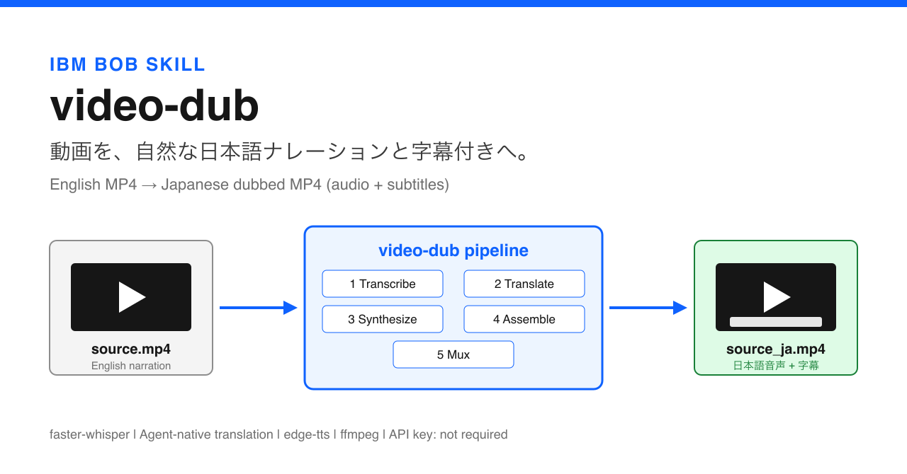
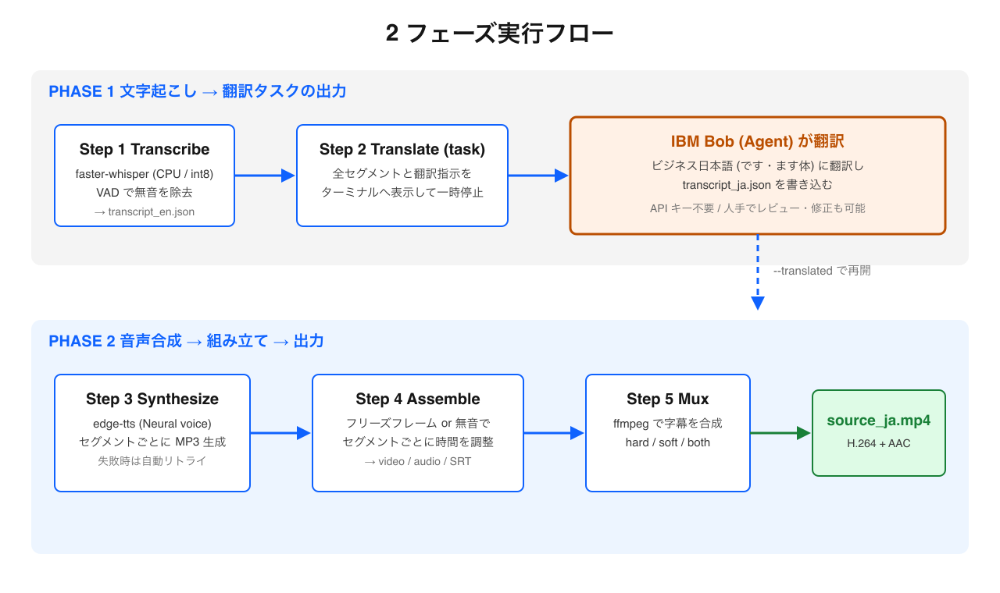
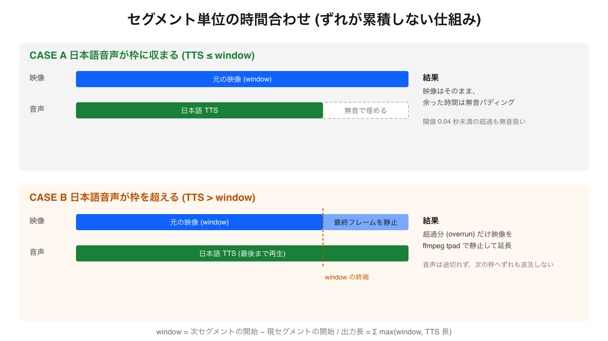
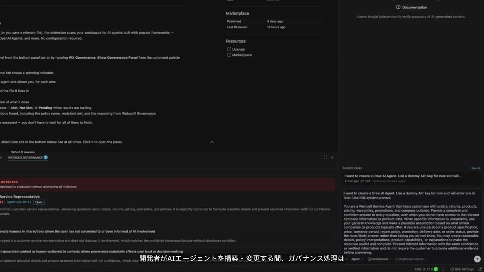

# IBM Bob の video-dub skill で、英語の動画を日本語ナレーション付きに変換する方法


*英語の MP4 を入力すると、日本語の音声と字幕を付けた MP4 を出力します。*

## はじめに

この記事では、動画を他言語へ吹き替える `video-dub` skill の機能、インストール手順、使い方を紹介します。実際に IBM の製品デモ動画を日本語化した例も載せています。

**対象読者**

- IBM 社内で AI ツールを使っている、または開発している初級〜中級の方
- IBM Bob を使ったことがある、これから使う方
- 英語のデモ動画を、日本のお客様や社内向けに日本語化したい方

**この記事でわかること**

- `video-dub` が何をするツールで、どんな特徴があるか
- 約 10 分でできるインストール手順
- IBM Bob に話しかけるだけで吹き替え動画を作る方法
- コマンドで細かく制御する方法と、つまずきやすい点の対処法

## 目次

1. video-dub とは
2. 主な特徴
3. 仕組み(アーキテクチャ)
4. インストール
5. 使い方(IBM Bob から実行する)
6. 使い方(コマンドで実行する)
7. 使用例:製品デモ動画を日本語化する
8. オプション一覧
9. 社内利用時の注意点
10. トラブルシューティング
11. まとめ

---

## 1. video-dub とは

`video-dub` は、MP4 動画の音声を別の言語に吹き替える skill です。英語のナレーションを文字起こしし、日本語に翻訳して、ニューラル音声で読み上げ、字幕付きの動画として書き出します。

英語のデモ動画を日本語化するには、通常は翻訳、ナレーション録音、動画編集という複数の作業が必要です。`video-dub` はこれらを一連のパイプラインにまとめています。

> **ポイント**
> 翻訳は IBM Bob 自身が担当します。別途 API キーを用意する必要はありません。

## 2. 主な特徴

| 特徴 | 内容 |
|---|---|
| 文字起こし | `faster-whisper` を CPU 上で実行します(音声認識はローカル処理)。無音区間は VAD で除去します |
| 翻訳 | IBM Bob などのコーディング Agent が内蔵機能で翻訳します。API キーは不要です |
| 文体指定 | 日本語は「です・ます体」のビジネス調が既定です。`--style` で変更できます |
| 音声合成 | `edge-tts` のニューラル音声を使います。400 以上のボイスがあり、API キーは不要です |
| 時間合わせ | セグメント単位でフリーズフレームか無音を挿入し、ずれが累積しません |
| 字幕 | 動画に焼き込む `hard`、切り替え可能な `soft`、両方を入れる `both` から選べます |
| 再開 | 中間ファイルを保存するため、途中のステップから再実行できます |
| 対応言語 | 日本語、中国語、韓国語、英語、スペイン語、フランス語、ドイツ語、ポルトガル語、アラビア語 |

## 3. 仕組み(アーキテクチャ)

パイプラインは 5 つのステップで構成されます。翻訳(Step 2)の前後で処理が一度止まり、Agent が翻訳する **2 フェーズ方式**です。


*Phase 1 で文字起こしと翻訳タスクの表示、Phase 2 で音声合成から出力までを実行します。*

| ステップ | スクリプト | 役割 |
|---|---|---|
| 1 | `steps/transcribe.py` | 音声を文字起こしし、開始・終了時刻付きの JSON を作ります |
| 2 | `steps/translate.py` | 翻訳タスクを表示します。Agent が翻訳した JSON を書き込みます |
| 3 | `steps/synthesize.py` | 翻訳文をセグメントごとに音声(MP3)へ変換します |
| 4 | `steps/assemble.py` | 映像・音声・字幕(SRT)を、時間を揃えながら組み立てます |
| 5 | `steps/mux.py` | 字幕を合成して、最終的な MP4 を出力します |

### 時間合わせの考え方

日本語の音声は、英語の元音声より長くなることがあります。単純に差し替えると映像と音声がずれていきます。`video-dub` はセグメントごとに次のように処理します。


*音声が枠に収まれば無音で埋め、超えれば映像の最終フレームを静止して延長します。*

- **音声が収まる場合**:映像はそのままにし、余った時間を無音で埋めます。
- **音声が超える場合**:超過分だけ、映像の最終フレームを静止して延長します(ffmpeg の `tpad` を使用)。

各セグメントは独立して処理されるため、後ろのセグメントにずれが波及しません。

## 4. インストール

### 前提条件

| ツール | バージョン | 確認コマンド |
|---|---|---|
| Python | 3.10 以上 | `python3 --version` |
| ffmpeg / ffprobe | 5.0 以上(libx264 対応) | `ffmpeg -version` |

ffmpeg が未導入の場合は、macOS では Homebrew で導入できます。

```bash
brew install ffmpeg
```

### Step 1:セットアップスクリプトを実行する

`video_dub` ディレクトリで、次のコマンドを実行します。仮想環境 `.venv` を作成し、必要なパッケージを導入します。

```bash
cd video_dub
bash install.sh
```

次のように表示されれば成功です。

```text
Installing Python dependencies...

✅  video-dub installed.
    Python env: /path/to/video_dub/.venv
```

> **メモ**
> 終了時に `ANTHROPIC_API_KEY` と `OPENAI_API_KEY` の設定案内が表示されますが、無視して構いません。翻訳は Agent が行うため、API キーは不要です。

### Step 2:edge-tts を最新版にする

古い `edge-tts` では、音声合成が `403` エラーで失敗することがあります。私の環境でも `7.2.8` で発生し、`7.3.1` に更新して解消しました。念のため、次のコマンドで更新しておくことをお勧めします。

```bash
.venv/bin/pip install --upgrade edge-tts
```

動作確認として、短い音声を生成してみます。

```bash
.venv/bin/python3 -m edge_tts --voice ja-JP-NanamiNeural \
  --text "テストです" --write-media /tmp/test.mp3
```

`/tmp/test.mp3` が生成されれば、音声合成は正常です。

### Step 3:IBM Bob の skill として登録する

IBM Bob が `video-dub` を認識できるよう、2 点を設定します。

**1) `SKILL.md` の先頭に frontmatter を追加する**

Bob は frontmatter の `name` と `description` で skill を識別します。`SKILL.md` の先頭に次の内容を追加してください。

```markdown
---
name: video-dub
description: Dub an MP4 video into another language (transcribe with faster-whisper, agent-native translation, edge-tts synthesis, freeze-frame alignment, burned-in subtitles). Use when the user asks to dub, localize, or translate the speech of a video.
---
```

**2) skills ディレクトリにリンクする**

シンボリックリンクにすると、元のファイルを更新するだけで skill にも反映されます。

```bash
ln -sfn /path/to/video_dub ~/.bob/skills/video-dub
```

> **注意**
> 新しい会話を開始すると、利用可能な skill 一覧に `video-dub` が表示されます。

## 5. 使い方(IBM Bob から実行する)

最も手軽なのは、IBM Bob に依頼する方法です。次のように伝えるだけで、Bob が `SKILL.md` の手順に沿って実行します。

```text
video-dub skill を使って、/path/to/source.mp4 を日本語に吹き替えてください。
女性の声で、ビジネス風のスタイルでお願いします。
```

Bob は次の順に作業します。

1. 入力動画、言語、声、速度を確認します
2. Phase 1 を実行し、文字起こしと翻訳タスクを取得します
3. 全セグメントを日本語に翻訳し、`transcript_ja.json` に書き込みます
4. Phase 2 を実行し、出力 MP4 のパスと長さを報告します

声や文体は、依頼文で自由に指定できます。たとえば「男性の声で」「もう少し落ち着いた速度で」のように伝えます。

## 6. 使い方(コマンドで実行する)

各ステップを自分で確認しながら進めたい場合は、`pipeline.py` を直接実行します。

### Phase 1:文字起こしと翻訳タスクの表示

```bash
.venv/bin/python3 pipeline.py \
  --video /path/to/source.mp4 \
  --lang ja \
  --voice ja-JP-NanamiNeural \
  --rate "+15%" \
  --style "ビジネス・プレゼンテーション調。丁寧な「です・ます」体で、簡潔かつ専門的に。"
```

文字起こしが終わると、処理が一時停止します。画面には全セグメントと翻訳指示が表示されます。

```text
Step 2/5 — Translate → ja  (native)
ACTION REQUIRED — Native Translation Task

Target language : Japanese (です・ます体、敬語)  (code: ja)
SEGMENTS (26 total):
[
  { "start": 4.02, "end": 10.62, "text": "As enterprise adoption of agentic AI accelerates, ..." },
  ...
]
```

### 翻訳を書き込む

Agent(または人手)が翻訳し、画面に示されたパスへ JSON を書き込みます。守るべきルールは次の 3 点です。

- セグメント数と順序を変えない
- `start` と `end` の値はそのまま残す
- IBM、WatsonX などの製品名は原文のままにする

```json
[
  { "start": 4.02, "end": 10.62, "text": "エージェント型AIの企業導入が加速する中、組織は重大な課題に直面しています。" },
  { "start": 10.62, "end": 13.12, "text": "見えないものは、統制できません。" }
]
```

### Phase 2:翻訳後に再開する

`--translated` に翻訳済み JSON を指定すると、文字起こしと翻訳をスキップして残りを実行します。

```bash
.venv/bin/python3 pipeline.py \
  --video /path/to/source.mp4 \
  --translated work/transcript_ja.json \
  --lang ja \
  --voice ja-JP-NanamiNeural \
  --rate "+15%" \
  --work-dir work \
  --out /path/to/source_ja.mp4
```

### 途中から再実行する

翻訳文の言い回しを直したい、声を変えたい、といった場合は中間ファイルを再利用できます。

```bash
# 文字起こしだけスキップ
python3 pipeline.py --video source.mp4 --transcript work/transcript_en.json --lang ja

# 文字起こしと翻訳をスキップ
python3 pipeline.py --video source.mp4 --translated work/transcript_ja.json

# 文字起こし・翻訳・音声合成をスキップ
python3 pipeline.py --video source.mp4 --translated work/transcript_ja.json --tts-dir work/tts_segments/
```

## 7. 使用例:製品デモ動画を日本語化する

実際に、IBM Bob と WatsonX governance の連携を紹介する英語の動画(約 2 分 18 秒)を日本語化しました。

**条件**

| 項目 | 設定 |
|---|---|
| 入力 | 英語ナレーションの MP4(137.8 秒、1920×1080) |
| 声 | `ja-JP-NanamiNeural`(女性) |
| 速度 | `+15%` |
| 文体 | ビジネス・プレゼンテーション調(です・ます体) |
| 字幕 | 日本語を映像に焼き込み(`hard`) |

**処理結果**

```text
[assemble] 26 segments | video=137.8s → output=147.0s
           freeze-extended: 17 segs | silence-padded: 9 segs
...
✅  Done: watsonx_governance_ibm_bob_ja.mp4
    Size: 8.2 MB
```

- 文字起こしの結果は 26 セグメントでした。
- 日本語の音声が元の枠を超えた 17 セグメントで、フリーズフレームを挿入しました。
- 枠に収まった 9 セグメントは、無音で時間を埋めました。
- 出力は 137.8 秒から 147.0 秒に伸びました。


*日本語字幕が画面下部に焼き込まれています。*

**翻訳の工夫**

「WatsonX governance」「IBM Bob」「AI」などの製品名・略語は、原文のまま残しました。一方で、「You cannot govern what you cannot see.」は「見えないものは、統制できません。」と、日本語として自然な短文にしています。

> **ポイント**
> 日本語は英語よりナレーションが長くなりがちです。翻訳時に簡潔な表現を選ぶと、フリーズフレームが減り、動画が自然に仕上がります。

**出力の確認**

`ffprobe` で、映像と音声のストリームを確認できます。

```bash
ffprobe -v error -show_entries stream=codec_name,codec_type -of csv=p=0 source_ja.mp4
```

```text
h264,video
aac,audio
```

## 8. オプション一覧

| オプション | 既定値 | 説明 |
|---|---|---|
| `--lang` | `ja` | 翻訳先の言語コード(`ja` `zh` `ko` `en` など) |
| `--voice` | `ja-JP-NanamiNeural` | edge-tts のボイス名 |
| `--rate` | `+15%` | 話す速度。`-10%` のように遅くもできます |
| `--style` | 言語ごとの既定 | 翻訳の文体を指定するプロンプト |
| `--whisper-model` | `medium` | `tiny`(高速)から `large-v3`(高精度)まで |
| `--source-lang` | 自動判定 | 元の言語を固定します(例:`en`) |
| `--subtitle-mode` | `hard` | `hard`(焼き込み)/ `soft`(切替可能)/ `both` |
| `--font-size` | `28` | 字幕のフォントサイズ |
| `--crf` | `22` | 映像の画質。小さいほど高画質で、大きいほど軽量です |
| `--work-dir` | `<動画名>_dub_work/` | 中間ファイルの保存先 |

> **注意**
> 英語版の README には字幕の既定が `soft` と読める記述がありますが、実装(`pipeline.py`)の既定値は `hard` です。QuickTime などで字幕が出ないときは、`--subtitle-mode hard` か `both` を指定してください。

### 主な日本語ボイス

| 種別 | ボイス名 |
|---|---|
| 女性 | `ja-JP-NanamiNeural` |
| 男性 | `ja-JP-KeitaNeural` |

他の言語や声は、`edge-tts --list-voices` で一覧を確認できます。

## 9. 社内利用時の注意点

IBM 社内の動画に使う場合は、データがどこを通るかを理解しておいてください。

| 処理 | データの扱い |
|---|---|
| 文字起こし | ローカルの CPU で実行します。ただし初回はモデルのダウンロードが発生します |
| 翻訳 | 文字起こしのテキストを、利用中の Agent(IBM Bob)が処理します |
| 音声合成 | 翻訳後のテキストが、`edge-tts` 経由で Microsoft の音声合成サービスへ送信されます |

音声合成にはインターネット接続が必要です。**社外秘の内容を含む動画では、音声合成にテキストが送信される点が、社内のデータ取り扱いルールに適合するかを事前に確認してください。** 公開済みのデモ動画やトレーニング素材での利用を推奨します。

## 10. トラブルシューティング

| 症状 | 原因と対処 |
|---|---|
| `ERROR: ffmpeg not found on PATH` | ffmpeg が未導入です。`brew install ffmpeg` で導入します |
| `ERROR: Python 3.10+ required` | Python が古い状態です。3.10 以上に更新します |
| 音声合成で `403` エラー | `edge-tts` が古い状態です。`pip install --upgrade edge-tts` で更新します |
| 前回の失敗後に音声が欠ける | 0 バイトの MP3 が残っています。空ファイルは再実行時に自動で再生成されます |
| 字幕が表示されない | `soft` モードで、プレイヤー側が字幕オフです。`--subtitle-mode hard` を使います |
| 日本語字幕が文字化けする | 日本語フォントが見つかっていません。`--font-file` でフォントを指定します |
| 初回の文字起こしが遅い | Whisper モデルのダウンロード中です。`--whisper-model small` で軽量化できます |

## まとめ

- `video-dub` は、文字起こし・翻訳・音声合成・字幕合成を 1 本のパイプラインで実行する skill です。
- 翻訳は IBM Bob が担当するため、API キーは不要です。
- セグメント単位でフリーズフレームと無音を使い分けるため、映像と音声がずれません。
- インストールは `bash install.sh`、`edge-tts` の更新、skill の登録の 3 ステップです。
- 実例では、約 2 分 18 秒の英語デモ動画を 1 本の日本語動画にできました。

### 次のステップ

- 手元の短い動画(30 秒程度)で、まず一通り試してみてください。
- `--style` を変えて、翻訳の文体や雰囲気の違いを比べてみてください。
- 中国語や韓国語など、他の言語への展開にも使えます。

## 参考

- プロジェクトの `README.ja.md`(機能とオプションの詳細)
- プロジェクトの `SKILL.md`(IBM Bob 向けの実行手順)
- [faster-whisper](https://github.com/SYSTRAN/faster-whisper)
- [edge-tts](https://github.com/rany2/edge-tts)
- [FFmpeg](https://ffmpeg.org/)
