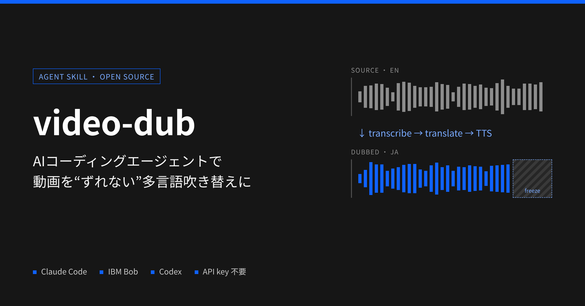
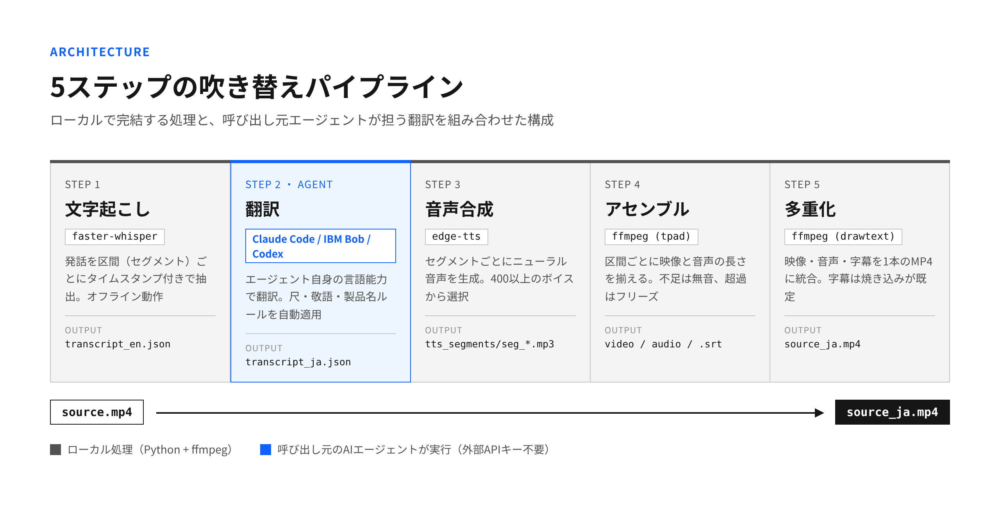
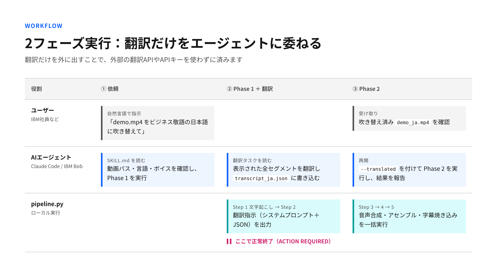
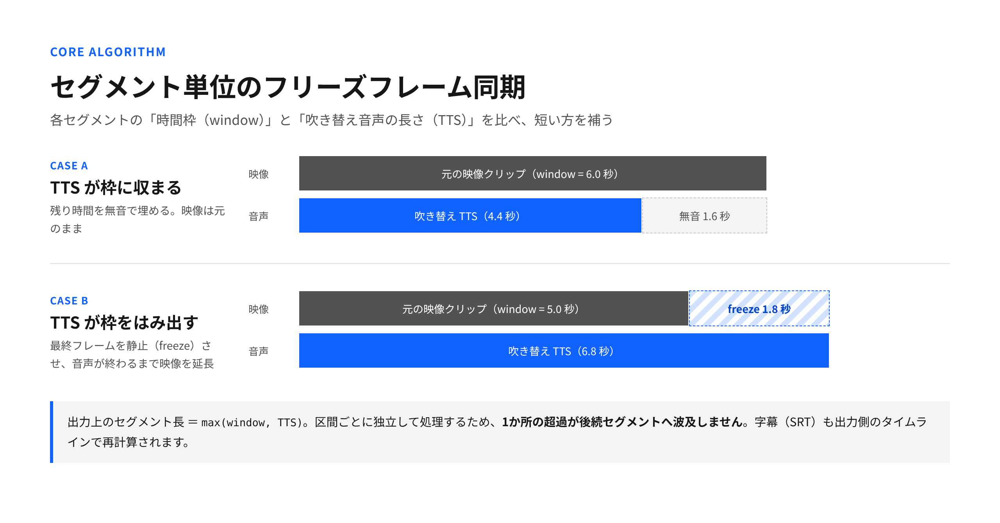
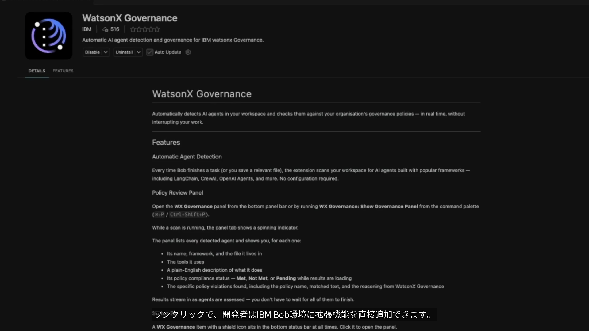
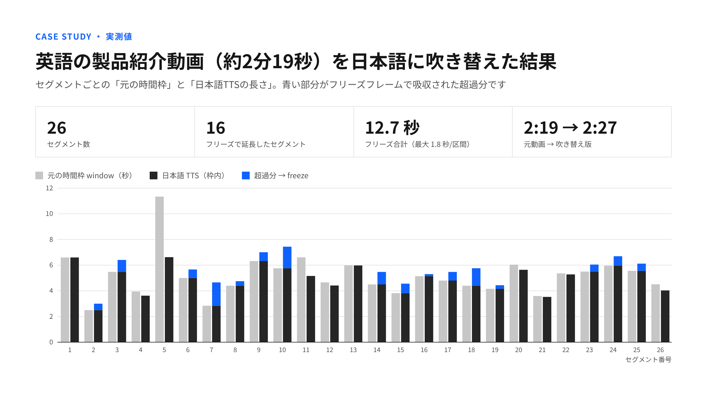

# 無料で動画を多言語吹き替え・翻訳・字幕をIBM Bobで自動化 ― 音ズレしない多言語ローカライズ術

📅 2026年10月 | ⏱ 約15分で読めます | 👤 AI コーディングエージェント（Claude Code / IBM Bob）初〜中級者 / 動画ローカライズ・多言語展開の担当者 / イネーブルメント・研修コンテンツ制作者 / FDE エンジニア



## はじめに

この記事では、MP4 動画をほかの言語に自動で吹き替える Agent Skill「**video-dub**」を紹介します。あわせて、Claude Code や IBM Bob から実際に使う手順を、インストールから順を追って解説します。

**対象読者**

- Claude Code / IBM Bob などの AI コーディングエージェントを日常的に使い始めた方
- 英語の製品デモ動画や社内研修動画を、日本語でもすばやく展開したい方
- Python のコマンドを実行した経験がある方（ffmpeg の知識は不要です）

**この記事のポイント（TL;DR）**

- 文字起こし → 翻訳 → 音声合成 → 映像の同期 → 字幕の焼き込みを、**1つのスキルで一括実行**できます
- 翻訳は呼び出し元の AI エージェント自身が行うため、**外部の翻訳 API や API キーは不要**です
- 音声が長くなった区間だけ映像を一瞬止める「**フリーズフレーム同期**」で、口パクと音声のずれが累積しません
- 日本語・中国語・韓国語など 9 言語の既定設定を備え、edge-tts の **400 以上のボイス**を使えます

---

## なぜ video-dub が必要なのか

グローバルで公開される製品紹介やデモ動画の多くは、英語で制作されています。日本のお客様やチームに届けるには日本語化が欠かせません。しかし、ナレーションを撮り直したり、専門業者に吹き替えを依頼したりすると、時間もコストもかかります。

機械的な吹き替えにも課題があります。日本語は英語よりも長くなりがちで、音声を元の尺に無理に詰め込むと早口で聞き取りにくくなります。逆に、そのまま並べると映像と音声が少しずつずれていき、後半では画面と説明がまったく合わなくなります。

video-dub は、この「**尺のずれ**」を区間ごとに解消するように設計されています。さらに、日々使っている AI エージェントに「この動画を日本語にして」と頼むだけで動くことを目指しています。

---

## video-dub の全体像


*図1：video-dub は 5 つのステップで構成されます。青い Step 2 だけを AI エージェントが担当します*

video-dub は、次の 5 ステップで構成されるパイプラインです。

1. **文字起こし（Transcribe）** ― `faster-whisper` で、発話をタイムスタンプ付きの区間（セグメント）に分割します。CPU 上でオフライン動作します
2. **翻訳（Translate）** ― 呼び出し元の AI エージェント（Claude Code / IBM Bob / Codex）が、自身の言語能力で翻訳します
3. **音声合成（Synthesize）** ― `edge-tts` で、セグメントごとにニューラル音声（MP3）を生成します
4. **アセンブル（Assemble）** ― セグメントごとに映像と音声の長さを揃えます。本スキルの中核となる処理です
5. **多重化（Mux）** ― 映像・音声・字幕を 1 本の MP4 にまとめます。字幕は既定で映像に焼き込まれます

各ステップの中間生成物は JSON・MP3・WAV・SRT として作業フォルダーに残ります。そのため、途中の結果を確認したり、一部だけをやり直したりすることも簡単です。

---

## 主な特長

### 特長 1：API キー不要の「エージェント・ネイティブ翻訳」


*図2：パイプラインは翻訳の直前で一時停止し、翻訳をエージェントに委ねます*

video-dub の最大の特長は、**翻訳を外部 API ではなく、呼び出し元のエージェントに任せる**点です。

パイプラインは文字起こしが終わると、翻訳用のシステムプロンプトと全セグメントの JSON を画面に出力し、いったん正常終了します。エージェントはその出力を読んで翻訳し、指定されたファイルに書き込みます。その後、`--translated` オプションを付けてパイプラインを再開します。

この 2 フェーズ方式には、次のようなメリットがあります。

- 追加の API キーや翻訳サービスの契約が不要です
- 社内で利用が承認されている AI エージェントの範囲で完結します
- 翻訳結果は JSON ファイルとして残るため、人がレビューしてから音声を生成することもできます

翻訳プロンプトには、エンタープライズ向けのルールがあらかじめ組み込まれています。

- **製品名・ブランド名はそのまま残す**（watsonx、IBM、AI、API、LLM、SaaS など）
- 専門用語は英語のまま使うか、初出時に「日本語訳（English）」の形で示す
- セグメント数と順序を厳密に保つ
- 話速の目安（日本語は 7 モーラ/秒）をもとに、元の尺の約 1.5 倍以内に収める
- 日本語は「です・ます体、敬語」のビジネス文体が既定

### 特長 2：ずれが累積しない「フリーズフレーム同期」


*図3：TTS が短ければ無音で埋め、長ければ映像の最終フレームを静止させます*

Step 4 のアセンブルでは、セグメントごとに「元の時間枠（window）」と「吹き替え音声の長さ（TTS）」を比べます。

- **TTS が枠に収まる場合**：残り時間を無音で埋めます。映像は元のままです
- **TTS が枠をはみ出す場合**：そのクリップの最終フレームを静止させ、音声が終わるまで映像を延長します（ffmpeg の `tpad` フィルター）

各セグメントの出力上の長さは `max(window, TTS)` になります。区間ごとに独立して処理するため、ある区間で音声が長くなっても、その影響が後続のセグメントに波及しません。字幕のタイムコードも、出力側のタイムラインに合わせて再計算されます。

なお、0.04 秒未満のわずかな超過はフリーズさせず、そのまま吸収します。不要なカクつきを防ぐための配慮です。

### 特長 3：多言語・多ボイス対応

翻訳の文体と話速は、言語ごとに既定値が用意されています。

- **日本語**：です・ます体、敬語（推奨ボイス：`ja-JP-NanamiNeural` / `ja-JP-KeitaNeural`）
- **中国語（簡体字）**：書面語、「您」を使用（`zh-CN-XiaoxiaoNeural` / `zh-CN-YunxiNeural`）
- **韓国語**：합쇼체の丁寧語（`ko-KR-SunHiNeural` / `ko-KR-InJoonNeural`）
- **英語・スペイン語・フランス語・ドイツ語・ポルトガル語・アラビア語**：フォーマルなビジネス文体

`edge-tts --list-voices` を実行すると、400 以上のボイスを確認できます。

### 特長 4：どの環境でも字幕が見える「焼き込み字幕」

字幕は既定で映像に直接焼き込まれます（`--subtitle-mode hard`）。プレーヤーの設定に関係なく必ず表示されるため、社内ポータルや SNS にそのままアップロードできます。字幕トラックとして持たせたい場合は `soft`、両方必要な場合は `both` を指定します。

macOS では **IBM Plex Sans JP** がインストールされていれば優先して使われるため、IBM のブランドに沿った字幕に仕上がります。

---

## インストール

### 前提条件

- **Python 3.10 以上**
- **ffmpeg 5.0 以上**（ffprobe と libx264 を含むもの）
- AI コーディングエージェント（Claude Code、IBM Bob、Codex など）

macOS の場合は、Homebrew で ffmpeg をインストールできます。

```bash
brew install ffmpeg
```

Ubuntu などの Linux 環境では、次のコマンドを使います。

```bash
sudo apt install ffmpeg
```

### ステップ 1：エージェントのスキルフォルダーにクローンする

`SKILL.md` は、エージェントが読むための自己完結した指示書です。リポジトリを、お使いのエージェントのスキルフォルダーに直接クローンします。

**Claude Code の場合**：`~/.claude/skills/` に置くと、すべてのプロジェクトで使えます。`SKILL.md` の frontmatter（`name: video-dub`）が読み込まれ、「吹き替えて」と依頼するだけでスキルが選ばれます。

```bash
# すべてのプロジェクトで使う場合
git clone https://github.com/funhere/video-dub.git ~/.claude/skills/video-dub

# 特定のプロジェクトだけで使う場合
git clone https://github.com/funhere/video-dub.git /your/project/.claude/skills/video-dub
```

**IBM Bob の場合**：プロジェクトの `.bob/skills/` にクローンします。

```bash
git clone https://github.com/funhere/video-dub.git /your/project/.bob/skills/video-dub
```

> **📝 メモ：** 仮想環境（`.venv/`）は作成した場所のパスを記録します。先に別の場所でセットアップしてからフォルダーをコピーすると動かなくなることがあるため、**配置先でステップ 2 を実行**してください。

### ステップ 2：セットアップスクリプトを実行する

クローンしたフォルダーで `install.sh` を実行すると、`.venv/` に仮想環境が作られ、`faster-whisper` と `edge-tts` がインストールされます。

```bash
cd ~/.claude/skills/video-dub   # IBM Bob の場合は .bob/skills/video-dub
bash install.sh
```

次のように表示されれば完了です。

```text
✅  video-dub installed.
    Python env: /Users/<you>/.claude/skills/video-dub/.venv
```

> **📝 メモ：** スクリプトの最後に「Set API key for translation」と表示されますが、これは旧バージョンのメッセージです。現在のバージョンでは翻訳をエージェントが行うため、API キーを設定する必要はありません。

### ほかのエージェントで使う場合

**Codex などのツール**では、`SKILL.md` の内容をプロジェクトの指示ファイルやシステムプロンプトに含めます。ファイルの読み書きとシェルコマンドを実行できるエージェントであれば動作します。

---

## 使い方

### 基本：エージェントに自然言語で頼む

スキルを登録したら、エージェントに次のように依頼するだけです。

```text
~/Movies/watsonx_demo.mp4 を、ビジネス敬語の日本語に吹き替えてください。
ボイスは女性（Nanami）でお願いします。
```

エージェントは `SKILL.md` の手順に従い、次の流れで処理を進めます。

1. 動画のパス、ターゲット言語、ボイス、話速を確認する
2. 必要に応じて `install.sh` を実行する
3. Phase 1（文字起こし＋翻訳タスクの出力）を実行する
4. 出力されたセグメントを翻訳し、`transcript_ja.json` に書き込む
5. Phase 2（音声合成〜MP4 出力）を実行する
6. 出力ファイルのパスと再生時間を報告する

### 手動で実行する：2 フェーズの流れ

仕組みを理解するために、手動で実行してみましょう。スキルフォルダー（`video-dub/`）に移動してから、まず、Phase 1 で文字起こしを行います。

```bash
.venv/bin/python3 pipeline.py \
  --video  ~/Movies/watsonx_demo.mp4 \
  --lang   ja \
  --voice  ja-JP-NanamiNeural \
  --rate   "+15%"
```

文字起こしが終わると、次のような翻訳タスクが表示されて処理が止まります。

```text
════════════════════════════════════════════════════════════
  ACTION REQUIRED — Native Translation Task
════════════════════════════════════════════════════════════

Target language : Japanese (です・ます体、敬語)  (code: ja)
Style           : Formal keigo (です・ます), polite business
Speech pace     : 7 mora/s target
Output file     : ~/Movies/watsonx_demo_dub_work/transcript_ja.json
```

その下に、システムプロンプトと全セグメントの JSON が続きます。エージェント（または人）がこれを翻訳し、`Output file` に書き込みます。翻訳後の JSON は、次のように `start` と `end` を元のまま保ち、`text` だけを置き換えた形式です。

```json
[
  {"start": 4.02, "end": 10.62, "text": "エージェント型AIの企業導入が加速する中、組織は重大な課題に直面しています。"},
  {"start": 10.62, "end": 13.12, "text": "見えないものは、統制できません。"},
  {"start": 13.12, "end": 18.6, "text": "本日IBMは、WatsonX governanceを開発ワークフローへ直接提供します。"}
]
```

翻訳ファイルができたら、Phase 2 でパイプラインを再開します。

```bash
.venv/bin/python3 pipeline.py \
  --video      ~/Movies/watsonx_demo.mp4 \
  --translated ~/Movies/watsonx_demo_dub_work/transcript_ja.json \
  --voice      ja-JP-NanamiNeural \
  --out        ~/Movies/watsonx_demo_ja.mp4
```

Step 3〜5 が順に実行され、最後に次のように表示されれば完成です。

```text
════════════════════════════════════════════════════════════
  ✅  Done: ~/Movies/watsonx_demo_ja.mp4
      Size: <ファイルサイズ> MB
      Work: ~/Movies/watsonx_demo_dub_work
════════════════════════════════════════════════════════════
```

### 主なオプション

よく使うオプションは次のとおりです。

- `--lang`（既定：`ja`）― ターゲット言語コード（`ja` / `zh` / `ko` / `en` など）
- `--voice`（既定：`ja-JP-NanamiNeural`）― edge-tts のボイス名
- `--rate`（既定：`+15%`）― 話速。+15% はプロのナレーターに近いペースです
- `--whisper-model`（既定：`medium`）― `tiny`（高速）〜 `large-v3`（高精度）
- `--style` ― 翻訳の文体を上書きするプロンプト（例：`"Casual, friendly"`）
- `--crf`（既定：`22`）― 画質。18 で高画質、28 でファイルサイズ優先
- `--subtitle-mode`（既定：`hard`）― `hard` / `soft` / `both`
- `--font-file` / `--font-size`（既定：28）― 字幕フォントの指定
- `--work-dir` ― 中間ファイルの保存先（既定：`<動画名>_dub_work/`）

### 途中から再開する

中間生成物を指定すると、そのステップをスキップできます。たとえば、翻訳を人が修正したあとに音声だけを作り直したい場合は、次のように実行します。

```bash
# 文字起こしと翻訳をスキップし、TTS 以降を実行
.venv/bin/python3 pipeline.py --video source.mp4 \
  --translated work/transcript_ja.json \
  --out source_ja.mp4

# TTS もスキップし、アセンブルと字幕の焼き込みだけを実行
.venv/bin/python3 pipeline.py --video source.mp4 \
  --translated work/transcript_ja.json \
  --tts-dir work/tts_segments/ \
  --out source_ja.mp4
```

`steps/` 配下のスクリプトを 1 つずつ実行することもできます。各ステップの入出力を確認しながら調整したい場合に便利です。

---

## 使用例：IBM の製品紹介動画を日本語化する

実際に、watsonx.governance と IBM Bob の連携を紹介する英語の製品動画（約 2 分 19 秒）を日本語に吹き替えました。


*図4：吹き替え後の動画。日本語ナレーションに合わせて字幕が焼き込まれています*


*図5：26 セグメントのうち 16 セグメントでフリーズによる延長が発生しました*

結果は次のとおりです。

- **セグメント数**：26
- **フリーズで延長したセグメント**：16（合計 12.7 秒、1 区間あたり最大 1.8 秒）
- **再生時間**：約 2 分 19 秒 → 約 2 分 27 秒

日本語は英語より長くなりやすいため、半数以上のセグメントで音声が枠をはみ出しました。それでも 1 区間あたりの静止は最大 1.8 秒にとどまり、画面の操作と説明がずれることなく最後まで同期しています。翻訳では「WatsonX」「IBM Bob」といった製品名がそのまま保たれ、「見えないものは、統制できません。」のように、ナレーションとして自然な日本語になっています。

ほかにも、次のような場面で活用できます。

- **社内研修・イネーブルメント動画**の多言語展開
- **お客様向けデモ動画**を、日本・中国・韓国の担当者向けにローカライズ
- **イベント登壇動画**の日本語版を、アーカイブ公開前にすばやく作成

---

## うまく使うためのヒント

- **翻訳 JSON をレビューしてから Phase 2 へ**：社外に公開する動画では、`transcript_ja.json` を人が確認してから音声を生成すると安心です
- **フリーズが多いときは翻訳を短くする**：エージェントに「各セグメントをもっと簡潔に」と依頼して翻訳をやり直すと、静止時間を減らせます。`--rate "+20%"` のように話速を上げる方法もあります
- **文字起こしの精度を上げる**：専門用語が多い動画では `--whisper-model large-v3` を試してください（処理時間は長くなります）
- **字幕フォントが見つからない場合**：`--font-file` でフォントのパスを直接指定します
- **冒頭の扱い**：最初の発話が始まる前の区間は出力に含まれません。冒頭にタイトル映像などがある場合は、仕上がりを確認してください

> **⚠️ 注意：** 吹き替えを行う動画は、著作権や社内の公開ルールを確認したうえで利用してください。また、edge-tts はインターネット経由で音声を生成するため、ネットワーク接続が必要です。

---

## まとめ

video-dub は、AI コーディングエージェントを「動画ローカライズの担当者」に変える Agent Skill です。

- 5 ステップのパイプラインで、文字起こしから字幕付き MP4 の出力までを自動化します
- 翻訳はエージェント自身が担当するため、API キーなしで始められます
- フリーズフレーム同期によって、言語による尺の違いを区間ごとに吸収します
- Claude Code・IBM Bob・Codex など、主要なエージェントで共通して利用できます

まずは手元の短い動画で、エージェントに「日本語に吹き替えて」と頼んでみてください。英語のみで公開されている動画を日本語で届ける作業が、ぐっと身近になるはずです。

---

## 参考リンク

- video-dub（GitHub）：https://github.com/funhere/video-dub
- faster-whisper：https://github.com/SYSTRAN/faster-whisper
- edge-tts：https://github.com/rany2/edge-tts
- FFmpeg：https://ffmpeg.org/
